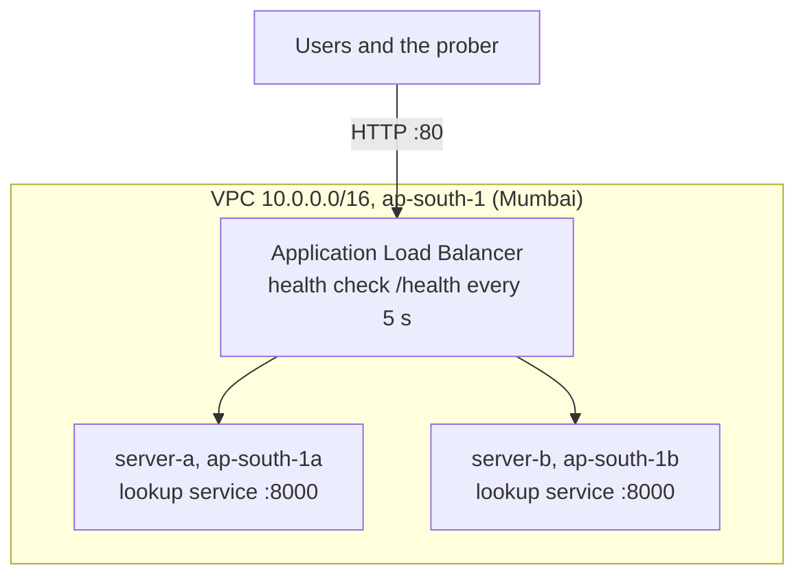

# CoWIN at national scale: multi-AZ failover on AWS

[](https://github.com/desairudra/COWIN-PROJECT-CLOUD-COMPUTING-PROJECT/actions/workflows/lookup-tests.yml)
[](https://github.com/desairudra/COWIN-PROJECT-CLOUD-COMPUTING-PROJECT/actions/workflows/db-tests.yml)
[](https://github.com/desairudra/COWIN-PROJECT-CLOUD-COMPUTING-PROJECT/actions/workflows/loadtest.yml)
[](https://github.com/desairudra/COWIN-PROJECT-CLOUD-COMPUTING-PROJECT/actions/workflows/k8s.yml)
[](https://github.com/desairudra/COWIN-PROJECT-CLOUD-COMPUTING-PROJECT/actions/workflows/cfn.yml)

IT457 Cloud Computing group project. Case study: CoWIN, India's COVID-19 vaccination platform,
which on 28 April 2021 had to absorb a national registration surge. We designed how such a
platform routes traffic across regions, then built and tested the core of it on AWS: a
small service running in two Availability Zones behind a load balancer, which stays online
when one zone is shut down.

Not affiliated with the official CoWIN platform. All centre data is made up.

**Live URL:** http://cowin-it457-alb-1251153005.ap-south-1.elb.amazonaws.com/centers
(live monitor: [`/monitor`](http://cowin-it457-alb-1251153005.ap-south-1.elb.amazonaws.com/monitor)).
The AWS setup is torn down between sessions to save cost, and the address changes when it is
rebuilt; see the [runbook](docs/runbook.md).

## Result

We stopped the Zone A server while the live site was taking 5 requests a second
(experiment E5, 900 requests per run):

| | Hard stop (no warning) | Graceful stop (drained first) |
| --- | --- | --- |
| Verdict | **Stayed up** | **Stayed up** |
| Requests failed after the stop | 35 of 599 (5.8%), all within 16 s | 2 of 599 (0.3%), client-side network blips |
| Longest time with no successful answer | **0.6 s** | **0.4 s** |
| Load balancer stopped using Zone A after | 16.1 s (2 failed health checks) | immediately (drained) |
| Availability over the whole run | 96.0% | 99.8% |

Before each stop, traffic was split evenly between the zones (151 / 149 and 150 / 151 requests).
A hard failure costs a short burst of errors until the health checks react; a planned
shutdown with draining is invisible to users. Full results, timelines and raw data:
[`docs/evidence/`](docs/evidence/).

Load test (commit 13): the same two servers behind the load balancer, k6 from a laptop in
steps of 60 s. **Every step up to 400 requests a second passed**: 46,505 requests, 0 failed,
split 50/50 between the zones, p95 latency 98 ms at the top step (30 ms at 25 requests a
second, mostly the network trip to Mumbai). Details:
[`docs/evidence/13-load-lookup-20261114-143527/`](docs/evidence/13-load-lookup-20261114-143527/results.md).

## The brief, step by step

| Step | What we did | Where |
| --- | --- | --- |
| 1. National-scale design | Mumbai + Hyderabad regions, Route 53 failover, load balancers across AZs, sharded database with cross-region replicas, recovery targets | [`docs/architecture/`](docs/architecture/README.md) |
| 2. Simple microservice | Vaccine Center Lookup: 20 centres as static JSON; every answer names the zone that served it | [`lookup/`](lookup/README.md) |
| 3. Two servers, two AZs | One EC2 server each in ap-south-1a and ap-south-1b, in a VPC where only the load balancer can reach them | [`infra/aws/`](infra/aws/README.md) (commits 4, 5) |
| 4. Load balancer | Application Load Balancer, health checks every 5 s, traffic split 50/50 | [`infra/aws/`](infra/aws/README.md) (commit 6) |
| 5. Failover test | Zone A stopped mid-traffic, measured from the user's side and the load balancer's | [`infra/aws/`](infra/aws/README.md) (commits 7, 8), results above |

## How it fits together



The servers accept port 8000 only from the load balancer's security group, so every request
goes through it. Each server is built from the repo at boot: the lookup app is packed into the
EC2 startup script, installed into a virtualenv and run under systemd. The national design
(two regions, Route 53, replicas) is in [`docs/architecture/`](docs/architecture/README.md);
we built one region of it.

## Repository

| Folder | What | Commit |
| --- | --- | --- |
| [`db/`](db/README.md) | PostgreSQL schema for the registration module: max 4 per mobile, unique photo ID, idempotent retries, hash partitioning; 42 tests | 1 |
| [`docs/architecture/`](docs/architecture/README.md) | National-scale multi-region design and diagram | 2 |
| [`docs/report/`](docs/report/) | Report section drafts | 2 |
| [`lookup/`](lookup/README.md) | Vaccine Center Lookup service and `/monitor` page; 27 tests | 3, 7 |
| [`infra/aws/`](infra/aws/README.md) | AWS CLI scripts: network, servers, load balancer, failover test, verification and teardown | 4-8 |
| [`docs/evidence/`](docs/evidence/README.md) | Command output, screenshots and test results from the real AWS account, by commit | 4-8 |
| [`docs/runbook.md`](docs/runbook.md) | Rebuild, demo and tear down, step by step | 9 |
| [`loadtest/`](loadtest/README.md) | k6 step load tests for the lookup service (through the ALB) and the sign-up flow, with charts | 13 |
| [`deploy/`](deploy/README.md) | Dockerfiles, the whole site in Docker Compose behind nginx, and a kind Kubernetes cluster with an autoscaler | 14 |
| [`experiments/k8s/`](experiments/k8s/README.md) | E1 autoscaling, E2 self-healing (pod and zone failures), E3 rolling update vs recreate | 14 |
| [`infra/cfn/`](infra/cfn/README.md) | The whole AWS setup as one CloudFormation stack, with an Auto Scaling group that replaces failed servers | 15 |
| [`experiments/e6_shard/`](experiments/e6_shard/README.md) | Registrations split over several databases by mobile number, and E6: one table vs partitioned vs sharded | 16 |
| [`docs/cost/`](docs/cost/README.md) | Cost model for 475-741 registrations/s, cloud vs on-premises, our real AWS bill; writes report Sec 6 | 17 |

## Run it locally

```bash
cd lookup
pip install -r requirements-dev.txt
pytest                                   # 27 tests
uvicorn app.main:app --port 8000         # http://localhost:8000/centers, /monitor, /docs
```

Database tests need Docker: see [`db/README.md`](db/README.md).
The whole site in containers: `docker compose -f deploy/compose/docker-compose.yml up -d --build --wait`,
then http://localhost:8090 (see [`deploy/README.md`](deploy/README.md)).
On AWS: follow the [runbook](docs/runbook.md).

## Team

| Member | Commits |
| --- | --- |
| Rudra | 1 database schema, 2 multi-region design, 4 AWS network |
| Harsh | 3 lookup service, 6 load balancer, 9 README and runbook |
| Viraj | 5 EC2 servers, 7 zone monitor, 8 failover test |

Next (phase 2): CloudWatch dashboard, registration API and website, rate limiter, load tests,
Kubernetes experiments, auto scaling, sharding, cost estimate and the remaining report sections.
