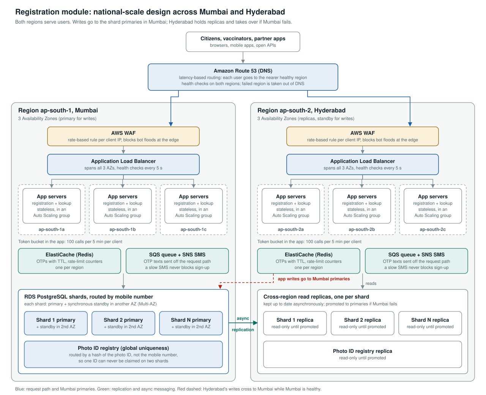

# National-scale architecture: registration across Mumbai and Hyderabad

**Commit 2 · Step 1 of the TA brief · report Sec 9.3**

The registration module runs in two AWS regions in India, Mumbai (ap-south-1) and
Hyderabad (ap-south-2), with three Availability Zones each. Route 53 sends each user to
the nearer healthy region. Inside a region, a load balancer spreads requests across
stateless servers in all three zones. Writes always go to database primaries in Mumbai;
Hyderabad keeps live replicas and takes over if Mumbai fails.

The PNG copy (`national-architecture.png`) is for the report.

## 1. How a request is routed

1. **DNS (Route 53).** The user's app looks up the service name. Route 53 uses
   *latency-based routing* to answer with the region closest to the user in network terms:
   most of western India lands on Mumbai, much of the south on Hyderabad. Route 53 health
   checks probe both regions. If a region fails its checks, Route 53 stops returning it, so
   new lookups all get the healthy region.
2. **Edge protection (AWS WAF).** A rate-based rule blocks a single IP that floods the
   service, before the request reaches a server. This is the coarse first filter.
3. **Load balancer (ALB).** The Application Load Balancer spans all three AZs of the
   region. It health-checks every server and sends each request only to healthy ones.
4. **App servers.** Stateless registration and lookup servers in an Auto Scaling group,
   spread over the three AZs. Being stateless (commit 11's design), any server can serve any
   request, so servers can be added, removed or lost without logging anyone out. Each
   server applies the fine-grained token bucket: 100 calls per 5 minutes per client, the
   limit CoWIN's public APIs used (report Sec 4.2).
5. **Cache and queue.** ElastiCache (Redis) in each region holds OTPs with a time-to-live,
   plus the rate-limit counters. OTP text messages go through an SQS queue to SNS, so a slow
   SMS gateway never holds up a sign-up. On 28 April 2021 about 1.45 crore SMS were sent
   (report Sec 4.4).
6. **Database.** Registration data is split into PostgreSQL shards by mobile number
   (commits 1 and 16). Each shard has its primary in Mumbai with a synchronous standby in a
   second Mumbai AZ (RDS Multi-AZ). Each shard also has an asynchronous cross-region read
   replica in Hyderabad.
   - **Reads** (list my beneficiaries, center lookup) are served in the user's own region.
   - **Writes** (add a beneficiary) always go to the Mumbai primary, even from Hyderabad
     servers. One writer per shard means no two regions can accept conflicting
     registrations, so the "never twice" rules stay true without cross-region locking.
7. **Photo ID registry.** The rule "one photo ID is registered only once" cannot be
   enforced inside a mobile-number shard, because the same ID could arrive under two mobiles
   on two shards. The registry is its own table, routed by a hash of the photo ID, and
   written in the same flow as the beneficiary (the design reason is in `db/README.md`).

## 2. What happens when something fails

| Failure | What notices | What takes over | Target recovery time (RTO) | Target data loss (RPO) |
| --- | --- | --- | --- | --- |
| One app server | ALB health check (2 failures × 5 s) | ALB stops sending it traffic; Auto Scaling replaces it | about 10 s | none: servers hold no data |
| One whole AZ | ALB health checks; RDS Multi-AZ monitoring | ALB uses the other two AZs; the RDS standby in another AZ becomes primary | under 2 min | none: the standby is synchronous |
| Whole Mumbai region | Route 53 health checks | DNS sends everyone to Hyderabad; Hyderabad replicas are promoted to primaries | reads within about 2 min (DNS); writes within 15 min | under 1 min of registrations |
| Hyderabad region | Route 53 health checks | DNS sends everyone to Mumbai; nothing else changes | about 2 min | none: Hyderabad holds no primaries |
| SMS provider slow or down | SQS queue depth alarm | Messages wait in the queue and are retried | sign-ups unaffected | none: queued |

The TA's Steps 3 to 5 build and test the first row on AWS: two servers in two AZs behind one
ALB, with the Zone A server shut down mid-demo (commits 4 to 8).

### Why these targets

- **AZ failure, zero data loss.** Losing a building is the common large failure. Multi-AZ
  replication is synchronous inside one region, so it costs little latency and loses nothing.
  It is worth paying for.
- **Region failure, up to 1 minute of data loss.** Synchronous replication between Mumbai and
  Hyderabad would slow every write by a cross-region round trip. That is a bad trade on a surge
  day like 28 April 2021, when roughly 475 to 740 registrations per second had to go through
  (report Sec 9.2). So cross-region replication is asynchronous, and a regional disaster may
  lose the last seconds of writes. That loss is recoverable: registration is idempotent
  (commit 1), so a citizen whose request was lost simply retries, and the retry cannot create
  a duplicate.
- **15 minutes to restore writes after a region loss.** Promoting replicas is a deliberate
  step, run from a tested runbook, not an automatic flip. A false alarm that promoted
  Hyderabad while Mumbai still accepted writes would split the data in two. Reads and center
  lookups keep working throughout, because they never needed Mumbai.

### Database choice: RDS PostgreSQL now, Aurora Global Database as the upgrade

The report (Sec 9.5) plans RDS for PostgreSQL with cross-region read replicas, which matches
our build. Aurora Global Database is the stronger option if the budget allows: AWS states
that it replicates to secondary regions using dedicated infrastructure, with latency typically
under a second, and that a secondary region can be promoted to take full read/write workloads
in under a minute ([AWS](https://docs.aws.amazon.com/rds/latest/auroraextendedcontent/aurora-faq-availability-and-durability.html)).
Note AWS also says that after an unplanned cross-region failover the RPO is typically a
non-zero value measured in seconds ([AWS](https://docs.amazonaws.cn/en_us/AmazonRDS/latest/AuroraUserGuide/aurora-global-database-disaster-recovery.html)),
so even Aurora does not make a regional failover lossless. Our 1-minute target covers either option.

## 3. Compared with CoWIN's likely 2021 setup

In April 2021 only one AWS region existed in India; Hyderabad opened in November 2022
(report Sec 4.4, and AWS's [region list](https://docs.aws.amazon.com/global-infrastructure/latest/regions/doc-history.html)).
So CoWIN most likely ran in Mumbai alone, across its AZs (inferred; not documented).

| | Single region (likely 2021) | This design |
| --- | --- | --- |
| Server or AZ failure | Survived, if spread across AZs | Survived |
| Whole region failure | Platform down until Mumbai recovers | Hyderabad takes over; reads in minutes, writes within 15 min |
| Latency for users far from Mumbai | Every request travels to Mumbai | Reads served from the nearer region |
| Bot floods (Sec 4.2) | API limit of 100 calls per 5 min per IP | Same limit, plus a WAF rule at the edge |
| Extra cost | none | A second region's servers, replicas and cross-region data transfer (priced in commit 17) |

## 4. Setup notes

- Hyderabad (ap-south-2) is an **opt-in region**: it must be enabled in the AWS account before
  use, while Mumbai is enabled by default ([AWS regions](https://docs.aws.amazon.com/global-infrastructure/latest/regions/aws-regions.html)).
  Both regions have three Availability Zones.
- Route 53 health checks should point at a health URL that checks the region end to end
  (load balancer, a server, and a read from the database). Otherwise a region with healthy
  servers but a dead database would keep receiving traffic.
- Keep the DNS TTL short (for example 60 s), so clients pick up a failover quickly.

## 5. What we build versus what we design

| Part | Status |
| --- | --- |
| One region, two AZs, ALB, failover test (TA Steps 2 to 5) | Built on AWS in commits 3 to 8 |
| Auto Scaling group, one-command setup | Built in commit 15 |
| Stateless registration API, idempotency, rate limiter, sharding | Built locally in commits 1, 11, 12, 16 |
| Second region, Route 53 failover, cross-region replicas, WAF, SQS/SNS | Designed here; not built, to keep cost down |

## Sources

- CoWIN figures: our Week 2 report (Sec 4.2, 4.4, 9.2, 9.3, 9.5), which cites the original sources.
- [AWS: Regions and Availability Zones](https://docs.aws.amazon.com/global-infrastructure/latest/regions/aws-regions.html): Hyderabad has 3 AZs and is opt-in.
- [AWS: Region launch history](https://docs.aws.amazon.com/global-infrastructure/latest/regions/doc-history.html): ap-south-2 launched November 2022.
- [AWS: Aurora availability and durability FAQ](https://docs.aws.amazon.com/rds/latest/auroraextendedcontent/aurora-faq-availability-and-durability.html): cross-region lag and promotion time.
- [AWS: Aurora Global Database switchover and failover](https://docs.amazonaws.cn/en_us/AmazonRDS/latest/AuroraUserGuide/aurora-global-database-disaster-recovery.html): RPO after unplanned failover.
