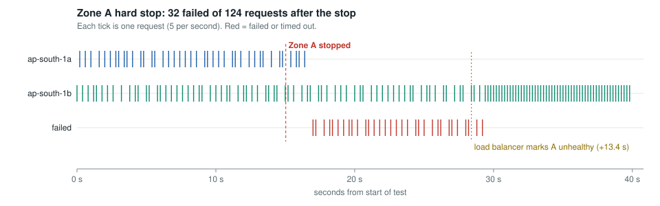

# Failover test (hard stop of Zone A)

Run `20261113-130346-hard` against `http://cowin-it457-alb-1251153005.ap-south-1.elb.amazonaws.com/health`: 200 requests at 5 per second over 40 s. Zone A's server (`i-09d9308771b77178b`, ap-south-1a) was stopped at t = 15 s.

**PASS: the site stayed up.** After the stop, 92 of 124 requests succeeded (74.2%). The longest stretch with no successful answer was 0.6 s, so a user retrying was never locked out for longer than that.

| Measure | Value |
| --- | --- |
| Requests before the stop: ap-south-1a / ap-south-1b / failed | 37 / 39 / 0 |
| Requests after the stop | 124 |
| Failed after the stop | 32 (25.8%) |
| Longest stretch with no successful answer | 0.6 s |
| Failure codes | 502 x18, TimeoutError x14 |
| First failure after the stop | 2.0 s |
| Last failure after the stop | 14.2 s |
| Last answer from ap-south-1a after the stop | 1.4 s |
| Load balancer marked Zone A unhealthy after | 13.4 s |
| Slowest successful answer after the stop | 5046 ms |
| Availability over the whole run | 84.0% |

Zone A target states seen by the load balancer (t in seconds from the start):

- t = 0.0 s: healthy
- t = 28.4 s: unhealthy
- t = 33.6 s: unused

Raw data: `probe.csv` (every request), `health.csv` (target health every 2 s), `run.env`.
