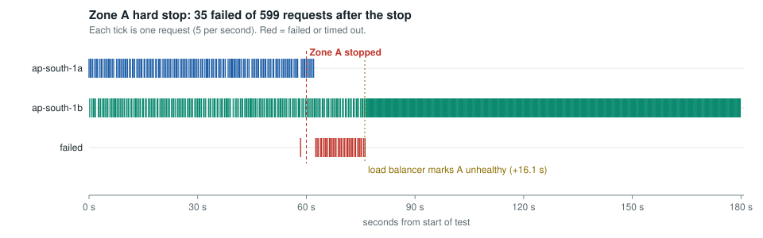

# Failover test (hard stop of Zone A)

Run `20261113-131045-hard` against `http://cowin-it457-alb-1251153005.ap-south-1.elb.amazonaws.com/health`: 900 requests at 5 per second over 180 s. Zone A's server (`i-09d9308771b77178b`, ap-south-1a) was stopped at t = 60 s.

**PASS: the site stayed up.** After the stop, 564 of 599 requests succeeded (94.2%). The longest stretch with no successful answer was 0.6 s, so a user retrying was never locked out for longer than that.

| Measure | Value |
| --- | --- |
| Requests before the stop: ap-south-1a / ap-south-1b / failed | 151 / 149 / 1 |
| Requests after the stop | 599 |
| Failed after the stop | 35 (5.8%) |
| Longest stretch with no successful answer | 0.6 s |
| Failure codes | TimeoutError x19, 502 x16 |
| First failure after the stop | 2.6 s |
| Last failure after the stop | 16.2 s |
| Last answer from ap-south-1a after the stop | 2.0 s |
| Load balancer marked Zone A unhealthy after | 16.1 s |
| Slowest successful answer after the stop | 5668 ms |
| Availability over the whole run | 96.0% |

Zone A target states seen by the load balancer (t in seconds from the start):

- t = 0.0 s: healthy
- t = 76.1 s: unhealthy
- t = 84.3 s: unused

Raw data: `probe.csv` (every request), `health.csv` (target health every 2 s), `run.env`.
