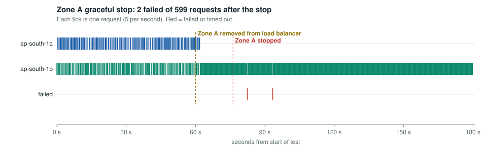

# Failover test (graceful stop of Zone A)

Run `20261113-131624-graceful` against `http://cowin-it457-alb-1251153005.ap-south-1.elb.amazonaws.com/health`: 900 requests at 5 per second over 180 s. Zone A's server (`i-09d9308771b77178b`, ap-south-1a) was stopped at t = 60 s.

**PASS: the site stayed up.** After the stop, 597 of 599 requests succeeded (99.7%). The longest stretch with no successful answer was 0.4 s, so a user retrying was never locked out for longer than that.

| Measure | Value |
| --- | --- |
| Requests before the stop: ap-south-1a / ap-south-1b / failed | 150 / 151 / 0 |
| Requests after the stop | 599 |
| Failed after the stop | 2 (0.3%) |
| Longest stretch with no successful answer | 0.4 s |
| Failure codes | URLError x2 |
| First failure after the stop | 22.4 s |
| Last failure after the stop | 33.4 s |
| Last answer from ap-south-1a after the stop | 1.8 s |
| Load balancer marked Zone A unhealthy after | 0.4 s |
| Slowest successful answer after the stop | 5063 ms |
| Availability over the whole run | 99.8% |

Zone A target states seen by the load balancer (t in seconds from the start):

- t = 0.0 s: healthy
- t = 60.4 s: draining

Raw data: `probe.csv` (every request), `health.csv` (target health every 2 s), `run.env`.
