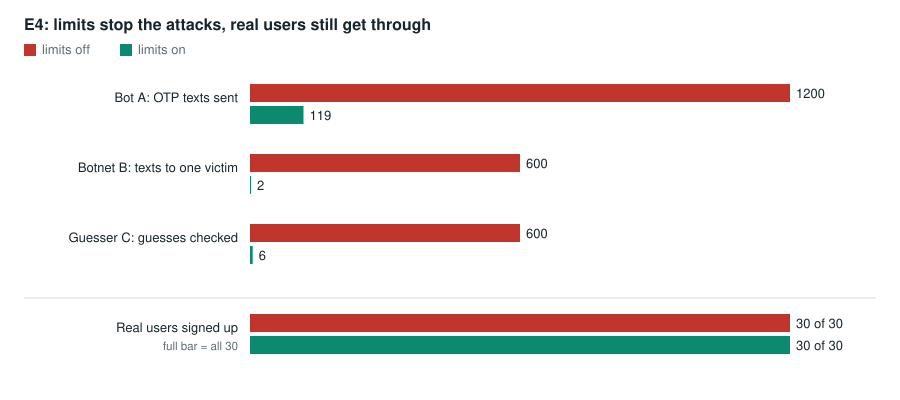

# E4: OTP flood, limits off vs on

Run 2026-11-14 12:37 UTC, 60 s per mode, 30 real users per mode, service on one machine with Redis and PostgreSQL.

**With the limits on, bot A got 119 OTP texts sent instead of 1200, the victim's phone got 2 instead of 600, and the guesser had 6 guesses checked instead of 600. 30 of 30 real users signed up (30 of 30 with the limits off).**

| Actor | Measure | Limits off | Limits on |
| --- | --- | --- | --- |
| A: one machine, random numbers, 20/s | OTP texts sent (SMS cost) | 1200 of 1200 | 119 of 1200 |
| | Requests refused (429) | 0 | 1081 |
| B: 50 machines, one victim, 10/s | OTP texts to the victim's phone | 600 of 600 | 2 of 600 |
| C: guessing one OTP, 10/s | Guesses actually checked | 600 of 600 | 6 of 124 |
| | New OTPs it managed to get | 1 | 2 |
| Real users, 1 every 2 s | Completed sign-up (OTP, verify, add, list) | 30 of 30 (100%) | 30 of 30 (100%) |
| | Real-user requests refused (429) | 0 | 0 |
| | Sign-up time, median / 95th percentile | 26 / 54 ms | 34 / 53 ms |

Limits on: 100 calls per 5 minutes per client IP (token bucket in Redis), one OTP per mobile every 30 s and 5 per hour, 3 wrong guesses per OTP, each OTP usable once.

Why the guess cap matters: each guess has a one-in-a-million chance on a 6-digit OTP, so about a million guesses are needed on average. Unlimited, at 10 per second, that is about 28 hours; for a 4-digit OTP, about 17 minutes. With the limits on, the guesser gets 3 guesses per OTP and at most 5 OTPs an hour, so 15 guesses an hour: about 7.6 years for 6 digits, 28 days for 4.

Raw data: `requests-off.csv`, `requests-on.csv` (one row per request).
