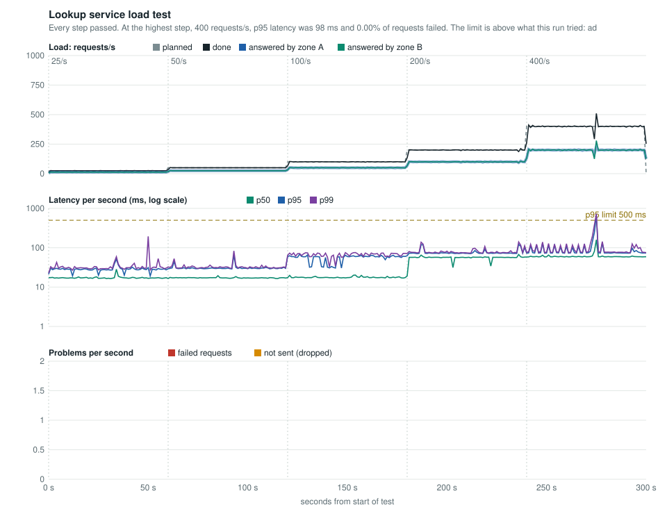

# Lookup service load test

Run 2026-11-14 14:35 UTC, steps of 60 s at 25, 50, 100, 200, 400 requests/s.

**Every step passed.** At the highest step, 400 requests/s, p95 latency was 98 ms and 0.00% of requests failed. The limit is above what this run tried: add a higher step to RATES to find it.

| Target | Load sent | p50 ms | p95 ms | p99 ms | Max ms | Failed | Zone A / B | Step |
| --- | --- | --- | --- | --- | --- | --- | --- | --- |
| 25 requests/s | 1501 of 1501 (100%) | 17 | 30 | 38 | 249 | 0 of 1501 (0.00%) | 50% / 50% | pass |
| 50 requests/s | 3001 of 3001 (100%) | 17 | 30 | 34 | 91 | 0 of 3001 (0.00%) | 50% / 50% | pass |
| 100 requests/s | 6001 of 6001 (100%) | 18 | 60 | 72 | 92 | 0 of 6001 (0.00%) | 50% / 50% | pass |
| 200 requests/s | 12001 of 12001 (100%) | 57 | 74 | 105 | 355 | 0 of 12001 (0.00%) | 50% / 50% | pass |
| 400 requests/s | 24001 of 24001 (100%) | 59 | 98 | 244 | 756 | 0 of 24001 (0.00%) | 50% / 50% | pass |

A step passes when at least 95% of the planned load was sent, p95 is under 500 ms and under 1% of requests failed. "Load sent" below 100% means answers were so slow that k6 ran out of virtual users and had to skip some of the planned load.

Per endpoint at 400 requests/s (highest step that passed):

| Endpoint | Requests | p50 ms | p95 ms | p99 ms | Failed |
| --- | --- | --- | --- | --- | --- |
| `by_city` | 11982 | 60 | 98 | 230 | 0 |
| `by_id` | 7147 | 59 | 100 | 236 | 0 |
| `by_pincode` | 4872 | 59 | 96 | 317 | 0 |

Target: `http://cowin-it457-alb-1251153005.ap-south-1.elb.amazonaws.com`
Data: `per_second.csv` (one row per second), `summary.json` (k6 end-of-test summary).
