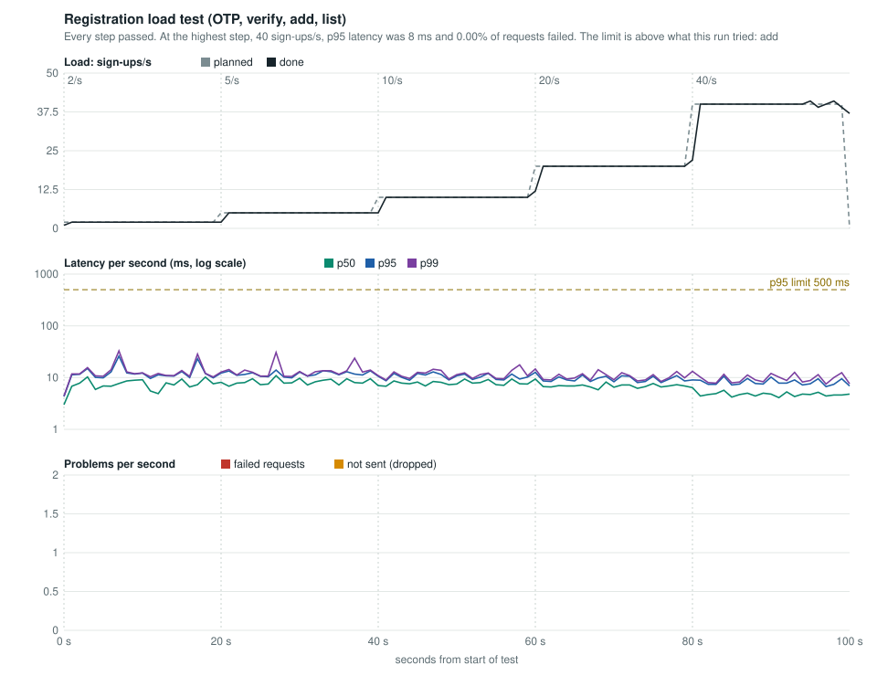

# Registration load test (OTP, verify, add, list)

Run 2026-11-14 14:22 UTC, steps of 20 s at 2, 5, 10, 20, 40 sign-ups/s.

**Every step passed.** At the highest step, 40 sign-ups/s, p95 latency was 8 ms and 0.00% of requests failed. The limit is above what this run tried: add a higher step to RATES to find it.

| Target | Load sent | p50 ms | p95 ms | p99 ms | Max ms | Failed | Sign-ups done | Step |
| --- | --- | --- | --- | --- | --- | --- | --- | --- |
| 2 sign-ups/s | 40 of 40 (100%) | 8 | 12 | 22 | 35 | 0 of 160 (0.00%) | 40 of 40 | pass |
| 5 sign-ups/s | 100 of 100 (100%) | 8 | 13 | 14 | 35 | 0 of 400 (0.00%) | 100 of 100 | pass |
| 10 sign-ups/s | 201 of 201 (100%) | 8 | 12 | 13 | 22 | 0 of 804 (0.00%) | 201 of 201 | pass |
| 20 sign-ups/s | 401 of 401 (100%) | 7 | 10 | 11 | 27 | 0 of 1604 (0.00%) | 401 of 401 | pass |
| 40 sign-ups/s | 800 of 800 (100%) | 5 | 8 | 11 | 26 | 0 of 3200 (0.00%) | 800 of 800 | pass |

A step passes when at least 95% of the planned load was sent, p95 is under 500 ms and under 1% of requests failed. "Load sent" below 100% means answers were so slow that k6 ran out of virtual users and had to skip some of the planned load.

Per endpoint at 40 sign-ups/s (highest step that passed):

| Endpoint | Requests | p50 ms | p95 ms | p99 ms | Failed |
| --- | --- | --- | --- | --- | --- |
| `add_beneficiary` | 800 | 5 | 8 | 11 | 0 |
| `list_beneficiaries` | 800 | 3 | 8 | 11 | 0 |
| `otp_request` | 800 | 5 | 8 | 11 | 0 |
| `otp_verify` | 800 | 5 | 8 | 10 | 0 |

Target: `http://localhost:8000`
Data: `per_second.csv` (one row per second), `summary.json` (k6 end-of-test summary).
