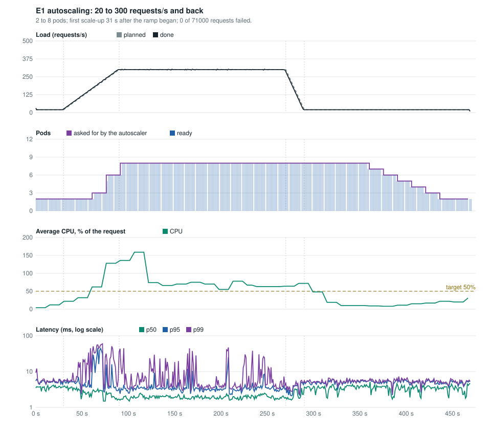

# E1 autoscaling: 20 to 300 requests/s and back

Load from k6 through nginx (`http://localhost:8080`): 20 requests/s, ramp to 300 in 60 s, hold 180s, back to 20 and wait 180s. Autoscaler: min 2, max 8, target 50% of the CPU request.

**The autoscaler went from 2 to 8 pods** and back to 2 181 s after the load dropped. First scale-up 31 s after the load started rising; 0 of 71000 requests failed.

| Measure | Value |
| --- | --- |
| First scale-up after the load started rising | 31 s |
| Most pods asked for | 8 |
| Most pods ready (reached after) | 8 (63 s) |
| Highest average CPU seen by the autoscaler | 159% of the request |
| Back to 2 pods after the load dropped | 181 s |
| Requests / failed | 71000 / 0 |

| Phase | Requests/s | p50 ms | p95 ms | p99 ms | Failed |
| --- | --- | --- | --- | --- | --- |
| Before the spike | 20 | 4 | 5 | 6 | 0 |
| Ramp up | 163 | 2 | 6 | 40 | 0 |
| First 30 s at peak | 300 | 2 | 3 | 7 | 0 |
| Last 60 s at peak | 300 | 2 | 3 | 6 | 0 |
| After the spike | 20 | 4 | 5 | 6 | 0 |

p95 was 3 ms in the first 30 s at peak and 3 ms in the last 60 s: about the same: the pods kept up from the start.

Raw data: `hpa.csv` (autoscaler every 5 s), `pods.csv` (pods every second), `per_second.csv`, `summary.json`.
