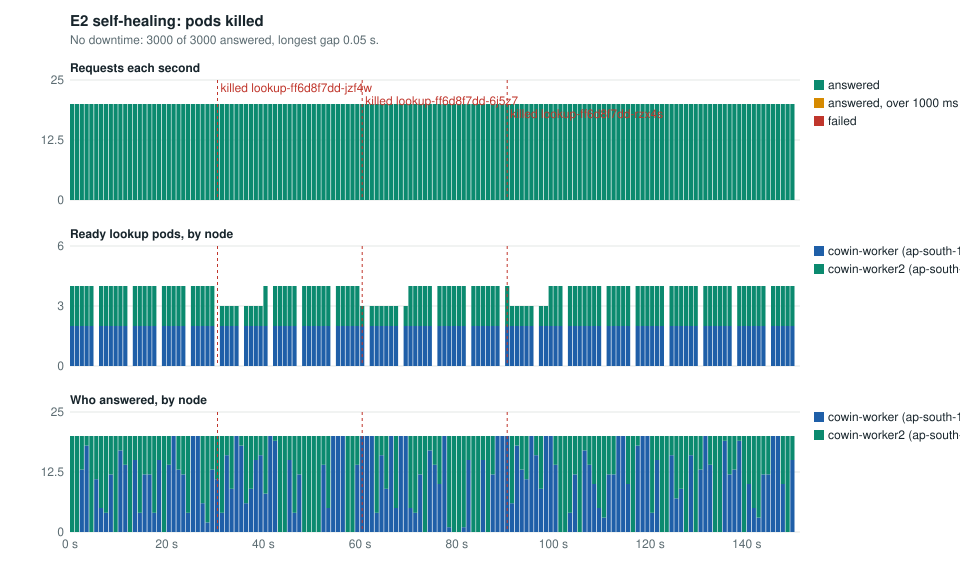

# E2 self-healing: pods killed

Probe: 20 requests a second for 150 s to `http://localhost:8080/centers?city=Mumbai`, 4 lookup pods to start with.

**No downtime.** 3000 of 3000 requests answered (100.00%); the longest stretch with no successful answer was 0.05 s (at t = 150 s).

| Measure | Value |
| --- | --- |
| Requests | 3000 |
| Failed | 0 |
| Slower than 1000 ms but answered | 0 |
| Longest time without a successful answer | 0.05 s |
| First / last failure | - / - |

| Event | At | Ready pods before | Back to that many after | Failed in the next 30 s |
| --- | --- | --- | --- | --- |
| killed lookup-ff6d8f7dd-jzf4w | 30.5 s | 4 | 9.5 s | 0 of 600 |
| killed lookup-ff6d8f7dd-6j5z7 | 60.4 s | 4 | 9.6 s | 0 of 600 |
| killed lookup-ff6d8f7dd-rzx4s | 90.4 s | 4 | 8.6 s | 0 of 600 |

Answers by node: cowin-worker (ap-south-1a) 1543, cowin-worker2 (ap-south-1b) 1457

Raw data: `probe.csv` (every request), `pods.csv` (lookup pods every second), `events.csv`, `nodes.csv`.
