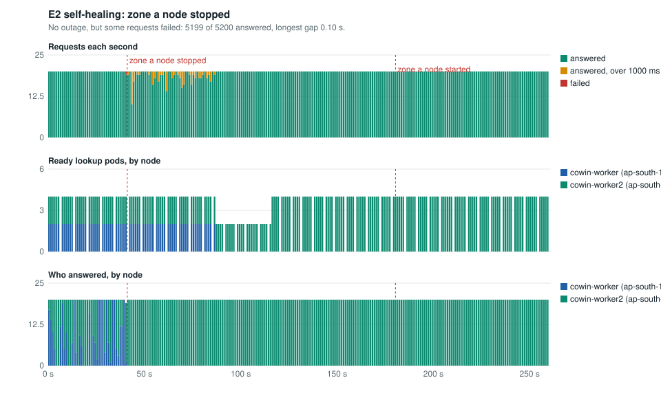

# E2 self-healing: zone a node stopped

Probe: 20 requests a second for 260 s to `http://localhost:8081/centers?city=Mumbai`, 4 lookup pods to start with.

**No outage, but some requests failed.** 5199 of 5200 requests answered (99.98%); the longest stretch with no successful answer was 0.10 s (at t = 40 s).

| Measure | Value |
| --- | --- |
| Requests | 5200 |
| Failed | 1 |
| Slower than 1000 ms but answered | 69 |
| Longest time without a successful answer | 0.10 s |
| First / last failure | 40.0 s / 40.0 s |
| Failure types | HTTP 502: 1 |

| Event | At | Ready pods before | Back to that many after | Failed in the next 30 s |
| --- | --- | --- | --- | --- |
| zone a node stopped | 41.0 s | 4 | 75.0 s | 0 of 600 |
| zone a node started | 180.3 s | 4 | - | 0 of 600 |

Answers by node: cowin-worker (ap-south-1a) 357, cowin-worker2 (ap-south-1b) 4842

Raw data: `probe.csv` (every request), `pods.csv` (lookup pods every second), `events.csv`, `nodes.csv`.
