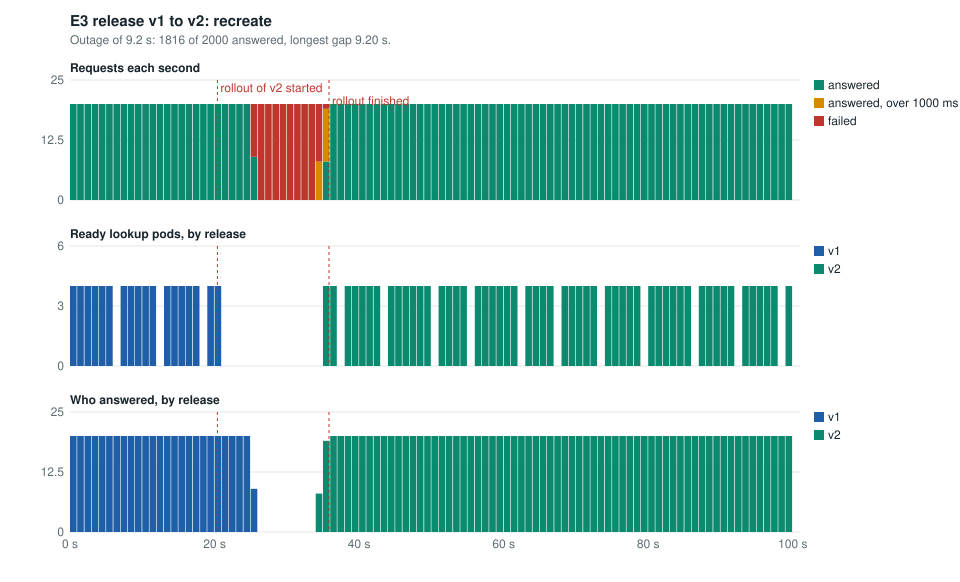

# E3 release v1 to v2: recreate

Probe: 20 requests a second for 100 s to `http://localhost:8080/centers?city=Mumbai`, 4 lookup pods to start with.

**Outage of 9.2 s.** 1816 of 2000 requests answered (90.80%); the longest stretch with no successful answer was 9.20 s (at t = 25 s).

| Measure | Value |
| --- | --- |
| Requests | 2000 |
| Failed | 184 |
| Slower than 1000 ms but answered | 19 |
| Longest time without a successful answer | 9.20 s |
| First / last failure | 25.4 s / 35.2 s |
| Rollout took (start to all new pods ready) | 15.4 s |
| First answer from v2 after the start | 14.2 s |
| v1 and v2 both answering for | 0.0 s |
| Failure types | HTTP 504: 96, TimeoutError: 70, HTTP 502: 18 |

| Event | At | Ready pods before | Back to that many after | Failed in the next 30 s |
| --- | --- | --- | --- | --- |
| rollout of v2 started | 20.4 s | 4 | - | 184 of 600 |
| rollout finished | 35.8 s | 4 | - | 0 of 600 |

Raw data: `probe.csv` (every request), `pods.csv` (lookup pods every second), `events.csv`, `nodes.csv`.
