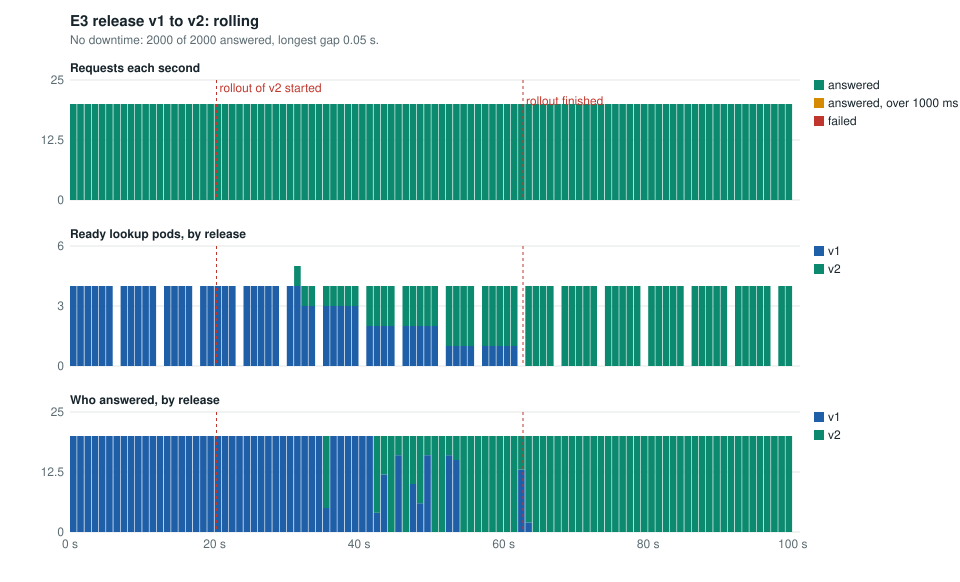

# E3 release v1 to v2: rolling

Probe: 20 requests a second for 100 s to `http://localhost:8080/centers?city=Mumbai`, 4 lookup pods to start with.

**No downtime.** 2000 of 2000 requests answered (100.00%); the longest stretch with no successful answer was 0.05 s (at t = 100 s).

| Measure | Value |
| --- | --- |
| Requests | 2000 |
| Failed | 0 |
| Slower than 1000 ms but answered | 0 |
| Longest time without a successful answer | 0.05 s |
| First / last failure | - / - |
| Rollout took (start to all new pods ready) | 42.4 s |
| First answer from v2 after the start | 14.8 s |
| v1 and v2 both answering for | 28.0 s |

| Event | At | Ready pods before | Back to that many after | Failed in the next 30 s |
| --- | --- | --- | --- | --- |
| rollout of v2 started | 20.3 s | 4 | - | 0 of 600 |
| rollout finished | 62.7 s | 4 | - | 0 of 600 |

Raw data: `probe.csv` (every request), `pods.csv` (lookup pods every second), `events.csv`, `nodes.csv`.
