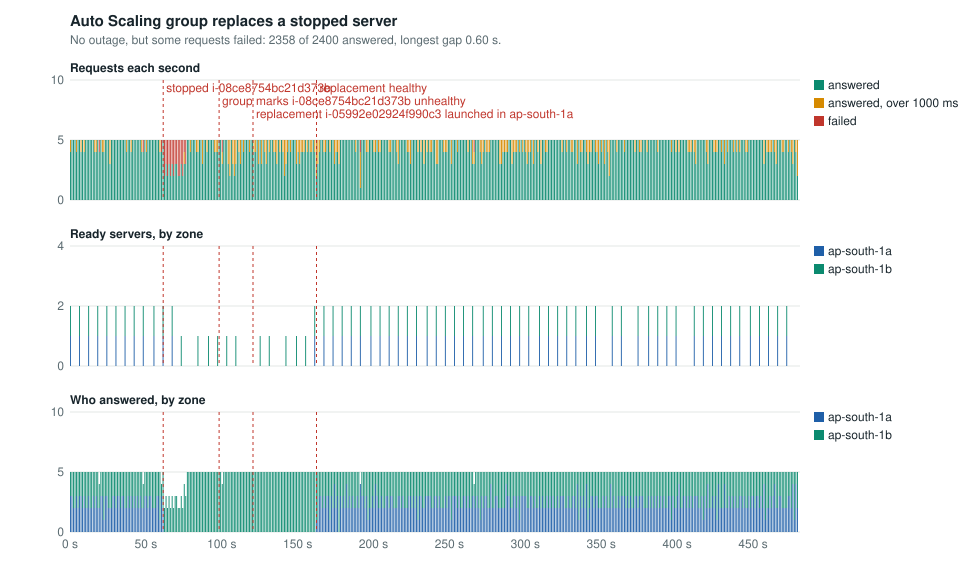

# Auto Scaling group replaces a stopped server

Probe: 5 requests a second for 480 s to `http://cowin-cfn-alb-858853683.ap-south-1.elb.amazonaws.com/centers?city=Mumbai`, 2 servers to start with.

**No outage, but some requests failed.** 2358 of 2400 requests answered (98.25%); the longest stretch with no successful answer was 0.60 s (at t = 71 s).

| Measure | Value |
| --- | --- |
| Requests | 2400 |
| Failed | 42 |
| Slower than 1000 ms but answered | 241 |
| Longest time without a successful answer | 0.60 s |
| First / last failure | 19.4 s / 266.8 s |
| Failure types | HTTP 502: 19, TimeoutError: 18, URLError: 5 |

| Event | At | Ready servers before | Back to that many after | Failed in the next 30 s |
| --- | --- | --- | --- | --- |
| stopped i-08ce8754bc21d373b | 61.4 s | 2 | 99.6 s | 36 of 150 |
| group marks i-08ce8754bc21d373b unhealthy | 98.2 s | 1 | - | 1 of 150 |
| replacement i-05992e02924f990c3 launched in ap-south-1a | 120.6 s | - | - | 0 of 150 |
| replacement healthy | 162.4 s | 2 | - | 1 of 150 |

Answers by zone: ap-south-1a 945, ap-south-1b 1413

Raw data: `probe.csv` (every request), `pods.csv` (lookup pods every second), `events.csv`, `nodes.csv`.
