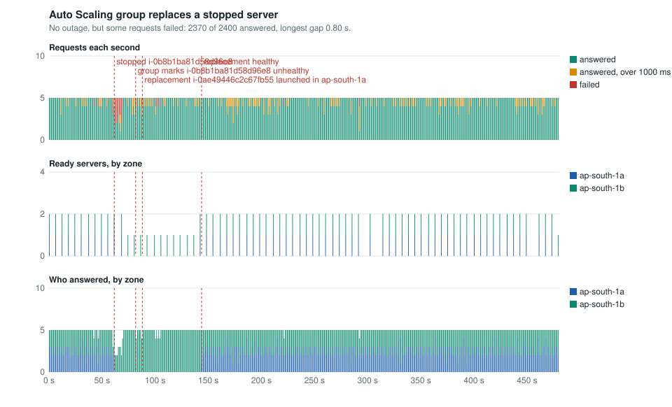

# Auto Scaling group replaces a stopped server

Probe: 5 requests a second for 480 s to `http://cowin-cfn-alb-1938869311.ap-south-1.elb.amazonaws.com/centers?city=Mumbai`, 2 servers to start with.

**No outage, but some requests failed.** 2370 of 2400 requests answered (98.75%); the longest stretch with no successful answer was 0.80 s (at t = 66 s).

| Measure | Value |
| --- | --- |
| Requests | 2400 |
| Failed | 30 |
| Slower than 1000 ms but answered | 153 |
| Longest time without a successful answer | 0.80 s |
| First / last failure | 42.6 s / 292.6 s |
| Failure types | HTTP 502: 17, URLError: 11, TimeoutError: 2 |

| Event | At | Ready servers before | Back to that many after | Failed in the next 30 s |
| --- | --- | --- | --- | --- |
| stopped i-0b8b1ba81d58d96e8 | 61.5 s | 2 | 80.5 s | 21 of 150 |
| group marks i-0b8b1ba81d58d96e8 unhealthy | 81.6 s | 1 | - | 5 of 150 |
| replacement i-0ae49446c2c67fb55 launched in ap-south-1a | 87.9 s | 1 | - | 3 of 150 |
| replacement healthy | 143.6 s | 2 | - | 0 of 150 |

Answers by zone: ap-south-1a 993, ap-south-1b 1377

Raw data: `probe.csv` (every request), `pods.csv` (lookup pods every second), `events.csv`, `nodes.csv`.
