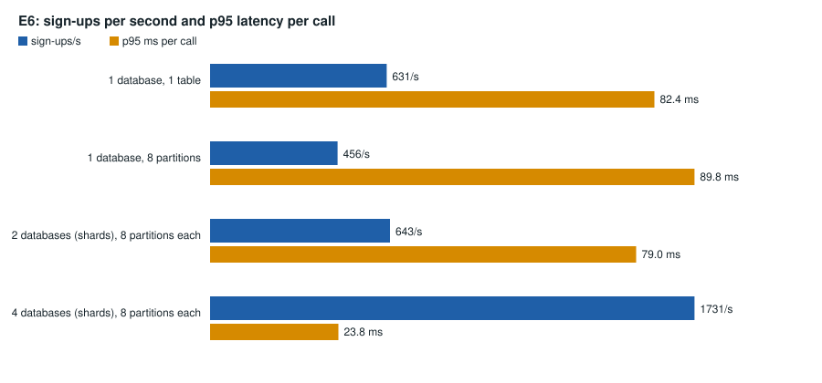

# E6: one table vs partitioned vs sharded

Run 2026-11-15 06:58 UTC. Each setup: empty schema, 20000 mobiles preloaded, then 4 x 8 clients signing people up for 30 s (register the mobile, add a beneficiary, list = 3 database calls). Every PostgreSQL server is limited to 1 CPU (`db/shards/docker-compose.yml`).

**4 databases (shards), 8 partitions each handled 1731 sign-ups/s, 2.7x the single table (631/s).** p95 per call: 82.4 ms on the single table, 23.8 ms here.

| Setup | Sign-ups/s | DB calls/s | vs 1 table | p50 ms | p95 ms | p99 ms | Errors | Query over everyone |
| --- | --- | --- | --- | --- | --- | --- | --- | --- |
| 1 database, 1 table | 631 | 1894 | 1.00x | 4.1 | 82.4 | 88.3 | 0 | 9 ms |
| 1 database, 8 partitions | 456 | 1367 | 0.72x | 4.2 | 89.8 | 94.7 | 0 | 11 ms |
| 2 databases (shards), 8 partitions each | 643 | 1929 | 1.02x | 5.1 | 79.0 | 91.9 | 0 | 28 ms |
| 4 databases (shards), 8 partitions each | 1731 | 5194 | 2.74x | 3.1 | 23.8 | 58.9 | 0 | 38 ms |

p95 per call type (ms):

| Setup | Register | Add beneficiary | List |
| --- | --- | --- | --- |
| 1 database, 1 table | 83.2 | 84.4 | 74.8 |
| 1 database, 8 partitions | 89.8 | 92.0 | 85.4 |
| 2 databases (shards), 8 partitions each | 72.8 | 86.7 | 10.9 |
| 4 databases (shards), 8 partitions each | 25.1 | 41.0 | 5.6 |

How evenly the mobiles were spread (registrations per database, and per partition in the first database):

| Setup | Per database | Largest / smallest | Per partition (database 1) |
| --- | --- | --- | --- |
| 1 database, 1 table | 38935 | 1.00 | 38935 |
| 1 database, 8 partitions | 33666 | 1.00 | 4226 / 4198 / 4329 / 4141 / 4110 / 4210 / 4259 / 4193 |
| 2 databases (shards), 8 partitions each | 19589 / 19704 | 1.01 | 2415 / 2439 / 2541 / 2399 / 2421 / 2467 / 2421 / 2486 |
| 4 databases (shards), 8 partitions each | 17834 / 18018 / 18011 / 18080 | 1.01 | 2230 / 2234 / 2237 / 2179 / 2177 / 2265 / 2263 / 2249 |

Notes:
- Adding a beneficiary on the sharded setups is two database calls inside: claim the photo ID on the shard that owns that ID, then insert on the mobile's shard (`ShardedDatabase` in `service/app/db.py`). That is the price of keeping photo IDs unique across databases.
- "Query over everyone" (people born before 1960) has to ask every shard and add the answers; that is the price of sharding for reports and analytics.
- Partitioning alone keeps one server: it makes each table and index smaller (faster vacuum, cheaper index maintenance), but it can't use more than one server's CPU.
- Sharding only adds capacity when each database has its own CPU. Here each container is capped at 1 CPU to stand in for separate machines; the client runs on the same laptop, so at some point the laptop itself becomes the limit.

