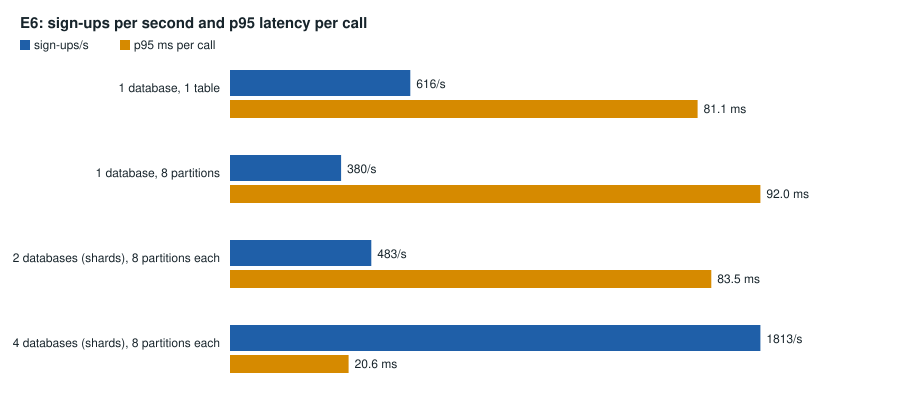

# E6: one table vs partitioned vs sharded

Run 2026-11-15 07:04 UTC. Each setup: empty schema, 20000 mobiles preloaded, then 4 x 8 clients signing people up for 60 s (register the mobile, add a beneficiary, list = 3 database calls). Every PostgreSQL server is limited to 1 CPU (`db/shards/docker-compose.yml`).

**4 databases (shards), 8 partitions each handled 1813 sign-ups/s, 2.9x the single table (616/s).** p95 per call: 81.1 ms on the single table, 20.6 ms here.

| Setup | Sign-ups/s | DB calls/s | vs 1 table | p50 ms | p95 ms | p99 ms | Errors | Query over everyone |
| --- | --- | --- | --- | --- | --- | --- | --- | --- |
| 1 database, 1 table | 616 | 1849 | 1.00x | 4.8 | 81.1 | 87.0 | 0 | 10 ms |
| 1 database, 8 partitions | 380 | 1140 | 0.62x | 5.4 | 92.0 | 96.8 | 0 | 13 ms |
| 2 databases (shards), 8 partitions each | 483 | 1449 | 0.78x | 7.4 | 83.5 | 96.5 | 0 | 19 ms |
| 4 databases (shards), 8 partitions each | 1813 | 5440 | 2.94x | 3.1 | 20.6 | 54.6 | 0 | 40 ms |

p95 per call type (ms):

| Setup | Register | Add beneficiary | List |
| --- | --- | --- | --- |
| 1 database, 1 table | 81.8 | 83.2 | 73.5 |
| 1 database, 8 partitions | 91.6 | 94.4 | 88.0 |
| 2 databases (shards), 8 partitions each | 75.6 | 92.4 | 66.4 |
| 4 databases (shards), 8 partitions each | 20.9 | 35.0 | 5.2 |

How evenly the mobiles were spread (registrations per database, and per partition in the first database):

| Setup | Per database | Largest / smallest | Per partition (database 1) |
| --- | --- | --- | --- |
| 1 database, 1 table | 56977 | 1.00 | 56977 |
| 1 database, 8 partitions | 42795 | 1.00 | 5334 / 5292 / 5493 / 5273 / 5257 / 5396 / 5360 / 5390 |
| 2 databases (shards), 8 partitions each | 24428 / 24544 | 1.00 | 3042 / 3016 / 3138 / 2986 / 3008 / 3078 / 3042 / 3118 |
| 4 databases (shards), 8 partitions each | 32001 / 32218 / 32301 / 32271 | 1.01 | 4024 / 4007 / 4023 / 3932 / 3931 / 3978 / 4037 / 4069 |

Notes:
- Adding a beneficiary on the sharded setups is two database calls inside: claim the photo ID on the shard that owns that ID, then insert on the mobile's shard (`ShardedDatabase` in `service/app/db.py`). That is the price of keeping photo IDs unique across databases.
- "Query over everyone" (people born before 1960) has to ask every shard and add the answers; that is the price of sharding for reports and analytics.
- Partitioning alone keeps one server: it makes each table and index smaller (faster vacuum, cheaper index maintenance), but it can't use more than one server's CPU.
- Sharding only adds capacity when each database has its own CPU. Here each container is capped at 1 CPU to stand in for separate machines; the client runs on the same laptop, so at some point the laptop itself becomes the limit.

